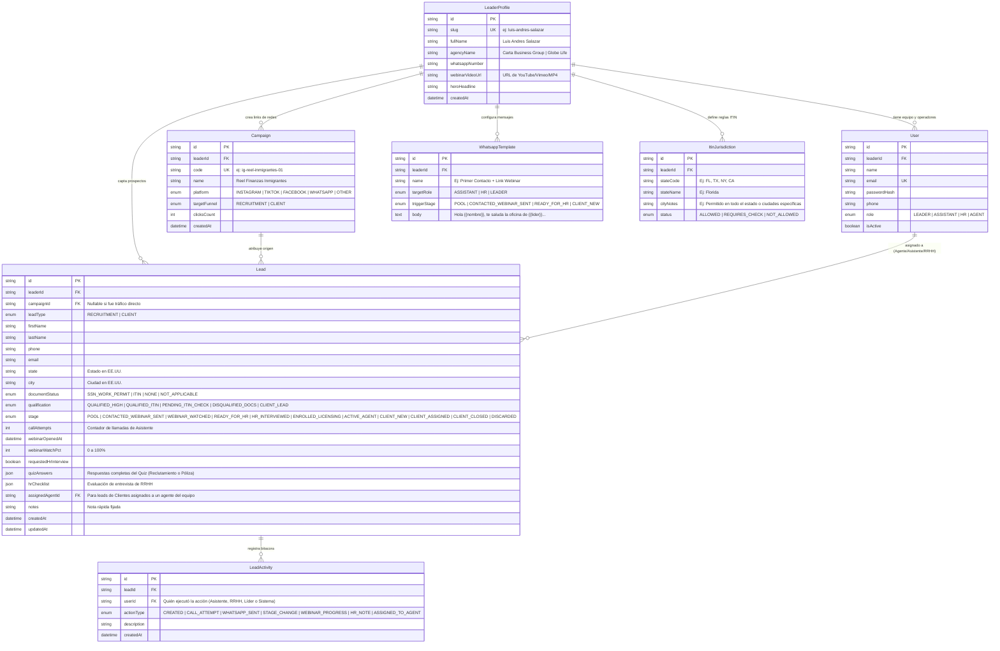

# Modelo de Datos en MySQL (`data-model.md`)

- **Motor de Base de Datos:** MySQL 8.x (Alojado en **Railway**)
- **ORM:** Prisma (`prisma/schema.prisma`)
- **Enfoque:** Preparado para Multi-Líder (`LeaderProfile`) para facilitar la venta del sistema a compañeros de Luis Andrés Salazar en Carta Business Group.

---

## 1. Diagrama Entidad-Relación (Mermaid)

---

## 2. Detalle de los Estados del Embudo (`Lead.stage`)

### A. Embudo de Reclutamiento de Agentes (`leadType = 'RECRUITMENT'`)
1. **`POOL` (En Piscina):** Estado inicial para candidatos calificados (`QUALIFIED_HIGH` o `QUALIFIED_ITIN`). Visible inmediatamente en la cola prioritaria de la **Asistente**.
2. **`CONTACTED_WEBINAR_SENT` (Contactado / Webinar Enviado):** La Asistente ya se comunicó y le compartió su link único de Webinar (`/webinar?lead={id}`).
3. **`WEBINAR_WATCHED` / `READY_FOR_HR` (Vio Webinar / Listo para RRHH):** Se activa automáticamente cuando el candidato supera el umbral del video o presiona el botón de solicitar entrevista en el Portal de Webinar (o cuando la Asistente lo promueve manualmente). Entra a la bandeja de **Recursos Humanos**.
4. **`HR_INTERVIEWED` (Entrevistado por RRHH):** RRHH realizó la entrevista de selección y llenó el checklist de evaluación.
5. **`ENROLLED_LICENSING` (Enrolado en Licencia - Pre-licensing):** ¡Hito clave de conversión! El candidato se inscribió oficialmente para estudiar y presentar el examen estatal de corredor de seguros.
6. **`ACTIVE_AGENT` (Agente Activo en el Equipo):** Aprobó la licencia y ya forma parte del equipo productivo de Luis Andrés.
7. **`DISCARDED` (Descartado / No Califica):** Incluye tanto a los que el sistema filtró automáticamente por falta de SSN/ITIN (`qualification = 'DISQUALIFIED_DOCS'`) como a los descartados manualmente por la Asistente o RRHH.

### B. Embudo de Clientes de Pólizas (`leadType = 'CLIENT'`)
1. **`CLIENT_NEW` (Nuevo Cliente Potencial):** Familia o individuo que solicitó cotización/asesoría de protección familiar (o reciclado desde el embudo de reclutamiento).
2. **`CLIENT_ASSIGNED` (Asignado a Agente del Equipo):** Luis Andrés se lo asignó a sí mismo o a un agente de su equipo (`assignedAgentId`) mediante el botón de envío por WhatsApp.
3. **`CLIENT_CLOSED` (Póliza Emitida / Cerrado):** Venta concretada.

